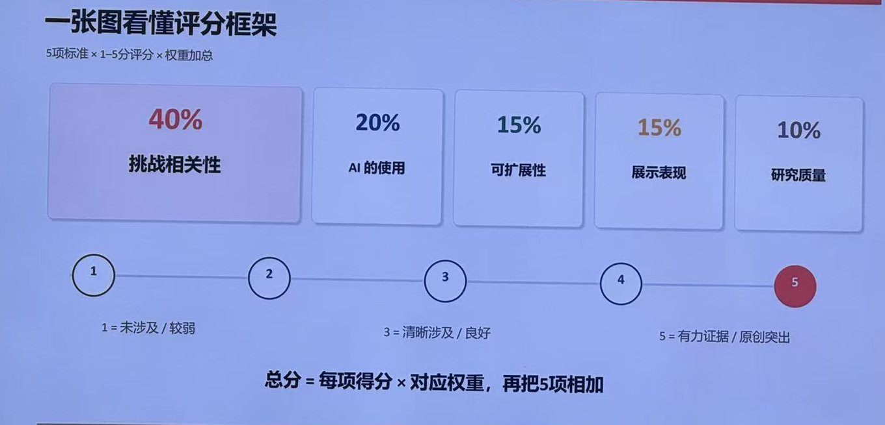
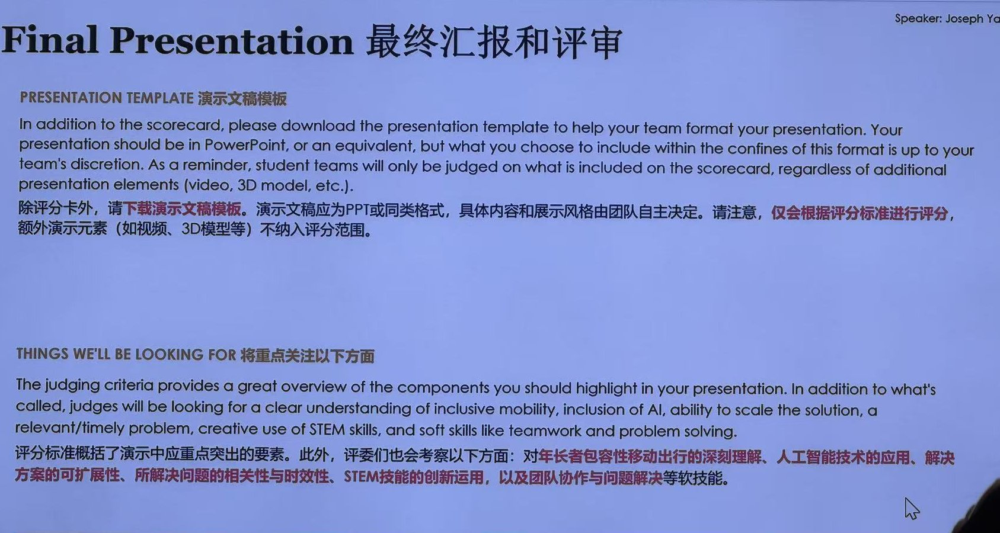
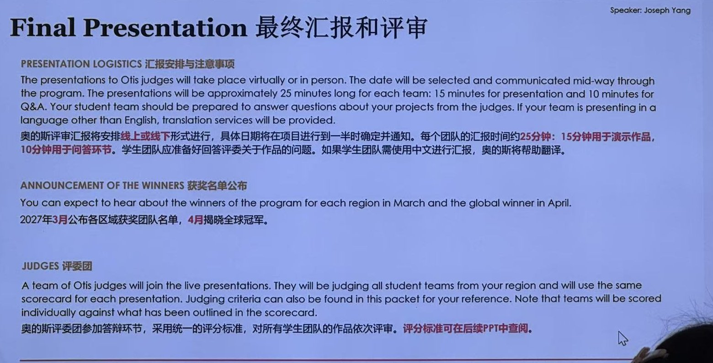
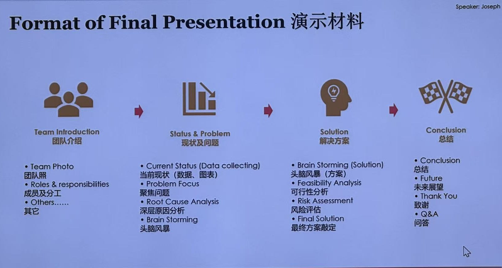
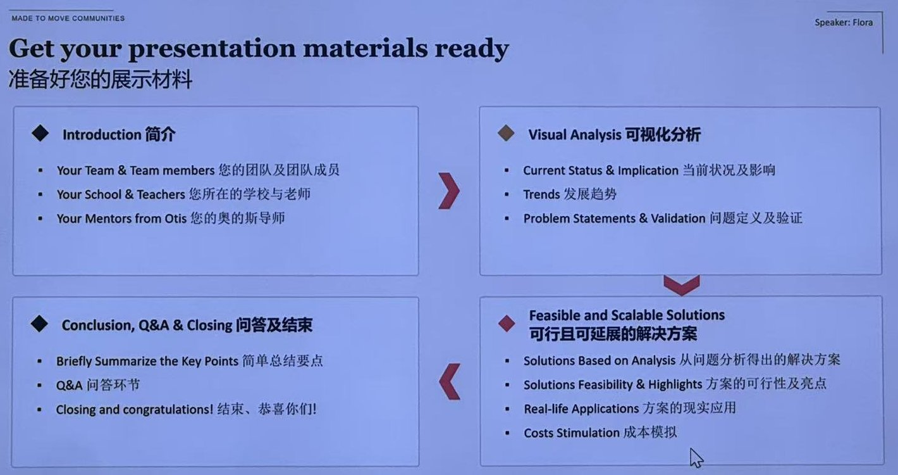

# MTMC7 第一课（2026 年 11 月）：评分标准与汇报要求

来源：Otis 线上第一课（MTMC7 lesson 1）的幻灯片，由队员现场拍照。照片已裁掉浏览器和参会人信息，原图见本文件夹。

## 1. 评分标准（Rubric）

5 项标准，每项 1–5 分，乘以权重后相加。

| 标准 | 权重 | 满分 5 分对应 |
|---|---|---|
| 挑战相关性 | **40%** | 有力证据 / 原创突出 |
| AI 的使用 | 20% | |
| 可扩展性 | 15% | |
| 展示表现 | 15% | |
| 研究质量 | 10% | |

评分刻度：1 = 未涉及 / 较弱，3 = 清晰涉及 / 良好，5 = 有力证据 / 原创突出。

**总分 = 每项得分 × 对应权重，再把 5 项相加。** 例如五项都拿 4 分，总分 = 4。

### 这对我们意味着什么

- **挑战相关性一项占四成**，比 AI 和研究加起来还多。每一页 PPT 都要回答：这如何帮老年人保持独立、获得基本服务、与社区保持联系。
- **只按评分卡打分**，视频、3D 模型等额外元素本身不加分。演示只有在证明"AI 真的在工作"或让展示更清楚时才有价值。
- **可扩展性单独占 15%**，要专门留一页讲：从一个小区推广到一个城市、全国、其他国家时，成本和做法怎么变。

## 2. 评委额外关注的方面

- 对年长者包容性出行的深刻理解
- 人工智能技术的应用
- 解决方案的可扩展性
- 所解决问题的相关性与时效性
- STEM 技能的创新运用
- 团队协作与问题解决等软技能

演示文稿用 PPT 或同类格式，内容和风格由团队决定（需下载官方模板）。

## 3. 汇报安排

- 线上或线下，日期在项目进行到一半时通知
- **每队约 25 分钟：15 分钟展示 + 10 分钟问答**
- 可以用中文汇报，Otis 提供翻译
- 同一区域所有队伍由同一组 Otis 评委、用同一张评分卡打分
- 2027 年 3 月公布区域获奖名单，4 月揭晓全球冠军

## 4. 演示文稿结构

| 部分 | 内容 |
|---|---|
| 团队介绍 | 团队照、成员及分工、其他 |
| 现状及问题 | 当前现状（数据、图表）、聚焦问题、**深层原因分析**、头脑风暴 |
| 解决方案 | 头脑风暴（方案）、**可行性分析**、**风险评估**、最终方案敲定 |
| 总结 | 总结、未来展望、致谢、问答 |

| 部分 | 内容 |
|---|---|
| 简介 | 团队及成员、学校与老师、**Otis 导师** |
| 可视化分析 | 当前状况及影响、发展趋势、**问题定义及验证** |
| 可行且可延展的解决方案 | 从问题分析得出的方案、可行性及亮点、现实应用、**成本模拟** |
| 问答及结束 | 简单总结要点、问答 |

加粗的几项是容易漏掉的：深层原因分析、问题验证、风险评估、成本模拟、介绍 Otis 导师。
